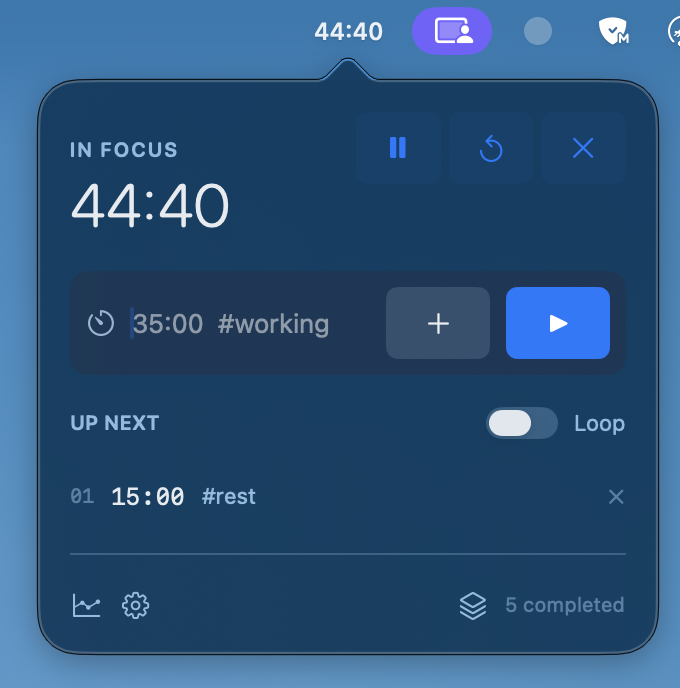
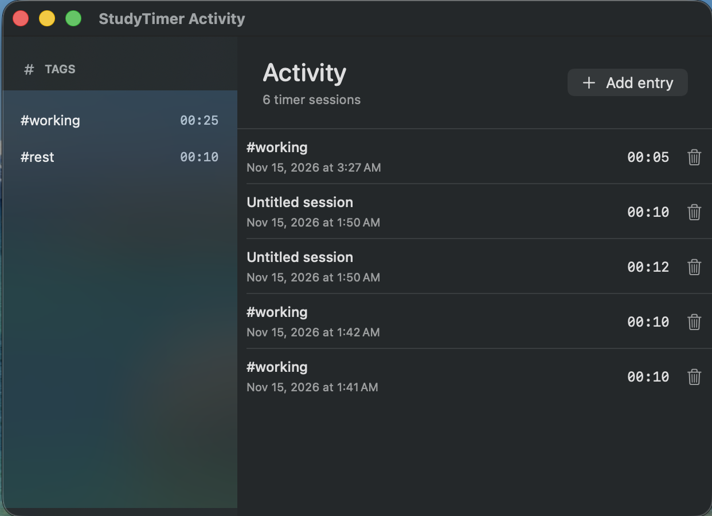
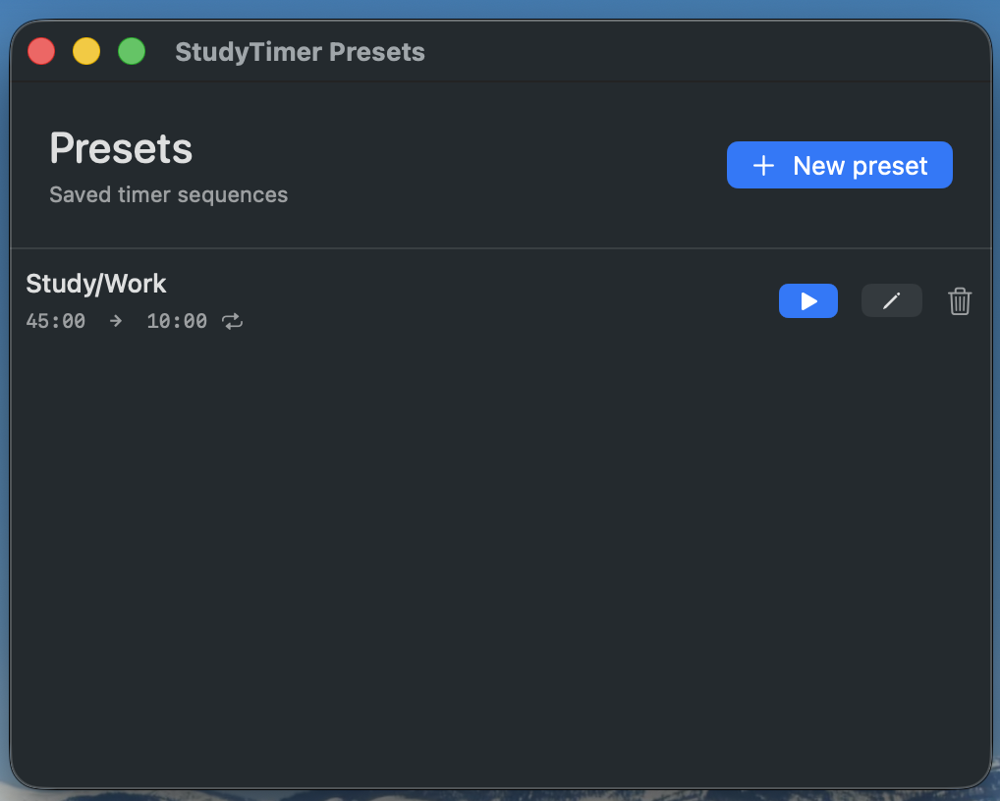
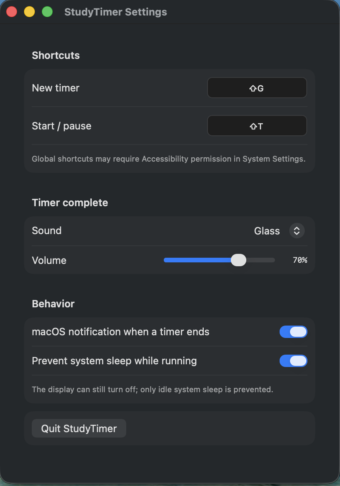

# StudyTimer

StudyTimer is a native macOS menu-bar timer for focused work and breaks. Its countdown lives in the menu bar, while a compact popover gives quick access to timer entry, queued sessions, and saved presets. Activity and settings open in separate macOS windows.

## Screenshots

### Timer

Start a tagged timer, queue the next session, toggle looping, or pause, reset, and cancel the active timer.



### Activity

Review completed sessions and total time by hashtag. Add a past session manually or remove a history entry.



### Presets

Save named timer sequences, including per-step tags and an optional loop, then start the whole sequence with one click.



### Settings

Choose a completion sound and volume, record keyboard shortcuts, enable macOS notifications, and prevent idle system sleep while a timer is running.



## Requirements

- macOS 14 or later
- Apple Silicon Mac

## Download and install

Download the latest `StudyTimer-1.0.0-macOS-arm64.zip` from the [GitHub Releases](https://github.com/DanielRomanovski/StudyTimer/releases/latest) page. Open the ZIP, then move `StudyTimer.app` into Applications.

This initial release is ad-hoc signed and not notarized by Apple. On first launch, Control-click the app in Applications, choose **Open**, and confirm the prompt. A Developer ID signature and notarization are required to remove this first-launch warning.

## Build and run

Building from source requires Swift 6 and the Xcode Command Line Tools.

From the repository directory, build and launch the app bundle:

```sh
./scripts/build-app.sh
open dist/StudyTimer.app
```

StudyTimer is a menu-bar-only app and does not appear in the Dock. After launch, find the `MM:SS` countdown in the menu bar and click it to open the timer popover. The local build is ad-hoc signed; distributing the app to other people requires signing and notarization with an Apple Developer account.

To compile without creating the app bundle:

```sh
swift build
```

## Using timers

Type a duration into the timer field and press Return or select the play button to start it. Durations can be entered as `MM:SS`, `HH:MM:SS`, seconds, or plain units. For example:

```text
35:00 #working
90:00 #writing
1:30:00 #project
45 min #break
```

Text after `#` becomes the session tag. Select `+` to add the entered timer to the queue. The Loop switch repeats the active timer or cycles through the active timer and queued timers. Use the pause button to pause or resume, the circular-arrow button to reset the active timer to its full duration, and `x` to cancel the active timer and clear the queue.

## Presets and activity

Select the stacked-layers button in the timer popover to open Presets. Create a name such as `Study` or `Games`, add and tag as many timer steps as needed, and turn on Loop to repeat the sequence. Presets are saved locally and can be edited, started, or deleted.

Select the chart button to open Activity. The sidebar totals the recorded duration for each tag. The session table lists completed and manually added entries; use **Add entry** to record a past session or the trash button to delete an entry. Manually added entries contribute to tag totals.

## Settings and data

Settings include timer-completion sounds, volume, optional macOS notifications, idle-sleep prevention, and configurable shortcuts for creating and starting or pausing a timer. macOS may require Accessibility or Input Monitoring permission for global keyboard shortcuts.

Timer history, preferences, queued timers, and presets are stored locally in the app's macOS user defaults. No account or network connection is required to use the app.

## Project layout

```text
Sources/StudyTimer/   SwiftUI views, timer state, and AppKit menu-bar integration
docs/images/          README screenshots
scripts/build-app.sh  Release build and local .app bundle creation
```

See [CHANGELOG.md](CHANGELOG.md) for release notes.